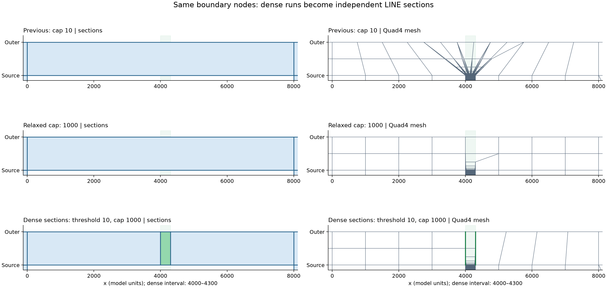

# mesher

`mesher` is a typed Python library for planar mixed Tri3/Quad4 meshes,
layered Wedge6/Hex8 extrusion, mesh quality checks, visualization, and the
process-flow geometry-to-CDB workflow.

The package is organized by responsibility:

- `mesher.mesh2d` owns planar models, generators, circular operations,
  quality checks, and 2D visualization.
- `mesher.mesh3d` owns solid models, process-flow extrusion, and 3D visualization.
- `mesher.meshcontrol` resolves Standard V1 geometry references and owns each
  control method's mesher-specific behavior.
- `mesher.mesh25d` translates Standard V1 geometry and coordinates the complete
  workflow through `plan2d.py` (2D meshing) and `plan3d.py` (3D meshing).
- `mesher.process_flow` owns the worker CLI, progress transport, and CDB export.

See [Architecture](docs/architecture.md) for the dependency rules,
[Mesh25D design](docs/mesh25d-design.md) for the architecture and data-flow diagrams,
and [Migrating to 0.2](docs/migration-0.2.md) for breaking import and field changes.

## Installation

Install the NumPy-only core:

```bash
python -m pip install .
```

Install optional capabilities independently:

```bash
python -m pip install '.[visualization]'
python -m pip install '.[gui]'
python -m pip install '.[process-flow]'
```

The basic `import mesher` path does not import PyVista, Matplotlib, PySide6,
or `process_flow_kernel`.

## Mesh models

The package root exports the central mesh models, planar topology enum, and geometry tolerance policy:

```python
from mesher import ElementType2D, GeometryTolerance, GeometryToleranceError, Mesh2D, Mesh3D, MeshSet
```

`Mesh2D` owns contiguous `float64` nodes with shape `(n, 3)` and `int32`
connectivity with shape `(m, 4)`. XY input is padded with a zero Z coordinate;
XYZ input must have exactly zero Z at every node, including unused nodes.
Nonzero Z (even tiny noise), NaN, and infinity raise `ValueError` with the first
invalid node's index and Z value. No Z tolerance or automatic projection is
applied. Use `Mesh2D.from_planar(nodes, elements, tolerance=policy)` for an explicit
projection that validates the total Z displacement against T.
Tri3 rows use `[n0, n1, n2, n2]`; `element_types` exposes the inferred topology.

`mesh.nodes` remains writable. Direct edits can temporarily make a mesh invalid;
public mesh operations validate Z before work, including no-op operations.
Getters remain available for inspection and repair. Constructors, the `nodes`
setter, and `replace_data` validate new coordinates before assigning them.
All 2D geometry uses XY and generated nodes have Z=0. `GeometryTolerance` has
only the positive `absolute` setting; relative and implicit planar tolerances
are not supported.
The 3D extruder validates its 2D source and generates Z from the layer plan.

`Mesh3D` owns `(n, 3)` nodes and fixed-width `(m, 20)` ANSYS connectivity.
`element_node_num` identifies the effective leading slots in each row; every
remaining slot repeats the last effective node id. Per-element `int32` arrays
store component, element-type, real-constant, and section ids, while `comps`,
`types`, `reals`, and `sections` hold their definition tables. The process-flow
extruder currently emits SOLID185 connectivity with eight effective slots.

`Mesh3D.sets` stores named node and element selections separately from components:

```python
from dataclasses import replace
from mesher import MeshSet

mesh = replace(mesh, sets={
    "fixed_nodes": MeshSet(kind="node", indices=[0, 3, 7]),
    "loaded_elements": MeshSet(kind="element", indices=[2, 5]),
})
fixed_coordinates = mesh.nodes[mesh.sets["fixed_nodes"].indices]
```

Set names are nonempty, case-sensitive strings in a shared namespace. Each set
contains explicit **zero-based row indices** into `nodes` or `elements`; sets may
overlap and may be empty. `MeshSet` copies, sorts, and deduplicates integer input
into a contiguous `int32` array. Floats, booleans, negative values, and `int32`
overflow are rejected; `Mesh3D` additionally checks bounds and copies all set
data. Omitting `sets` creates an independent empty dictionary. Frozen fields do
not make the dictionary or its arrays immutable.

`add_midside_node` preserves set membership without automatically adding new
nodes. The existing custom CDB text exporter revalidates and snapshots sets
before opening the output. Nonempty `sets` adds `set_count` and a
`*SETS,name_json,kind,indices_json` section, sorted by name, with one record per
set. For example, `"fixed_nodes",node,[0,3,7]` encodes the name and indices as
JSON; JSON escaping keeps names with quotes, commas, or newlines on one line.
Empty sets are exported as `[]`. With no sets, file contents are unchanged.
Export metadata always includes `setCount`, and progress counts one record per
set. This remains the repository's custom text format.

## Geometry tolerance

All geometry operations use an immutable `GeometryTolerance(absolute=0.001)` in
model coordinate units. Pass it as `tolerance=policy`; finite positive numeric
values are also accepted. Boundaries include distance exactly equal to T.
Normalization moves each point by at most T and rejects ambiguous groups,
conflicting fixed coordinates, and required features that would disappear.
Numeric precision, areas, angles, mesh sizes, and projection reach are separate
quantities. Coordinates unable to resolve T raise `numeric_resolution_exceeded`.

Process-flow mesh-control schema `1.1.0` accepts top-level `geometryTolerance`.
Existing `1.0.0` input remains supported and defaults to `0.001`. See the
[API migration guide](docs/tolerance-migration.md) for changed arguments,
error codes, and test migration reasons.

Process-flow normalization uses bounded XY equivalence before meshing: nearby
X/Y coordinates share one deterministic coordinate, and XY controls use the same
material anchors. Source Z coordinates and thicknesses are preserved; Z controls
and layer boundaries are not coalesced using geometryTolerance. Thin positive Z
layers are retained when their endpoints and subdivisions remain representable.
The bottom boundary sets use the exact minimum Z plane. Sub-tolerance XY gaps
between materials may close into shared interfaces. Each coordinate group must span at most T and each point must move
at most T in Euclidean distance; a chain whose total span exceeds T is rejected.
Collapsed XY footprints, distinct materials collapsing onto the same
volume, and separated existing interfaces still fail with source diagnostics.
This alignment does not impose a minimum mesh size or aspect-ratio guarantee.
CDB headers and worker metadata record `coordinateAlignment` and tolerance
policy version `3` (`bounded_xy_equivalence`).

## 3D mesh editing

`EditorMesh3D` is a stateless NumPy-only API. Boundary selection updates the
input mesh and returns it. `mesh25d.build_mesh()` already applies this operation
automatically; use the editor directly for meshes built through lower-level
APIs or to replace an existing selection:

```python
from mesher.mesh3d import EditorMesh3D

EditorMesh3D.set_boundary(mesh3d=mesh, model_type="upper_right_quarter")
fixed_x_nodes = mesh.sets["fix_x"].indices
fixed_x_coordinates = mesh.nodes[fixed_x_nodes]
```

All three node sets, `fix_x`, `fix_y`, and `fix_z`, contain the bottom cross.
Each retained arm contributes its nearest two nodes, plus one shared center.
The bottom is the minimum-Z plane; left/right refer to -X/+X and down/up to
-Y/+Y. Centers are inferred from the bottom nodes' XY bounds:

| `model_type` | Bottom center | Retained arms | Cross nodes | Additional symmetry constraints |
| --- | --- | --- | --- | --- |
| `full` | midpoint X, midpoint Y | left, right, up, down | 9 | None |
| `upper_half` | midpoint X, minimum Y | left, right, up | 7 | Entire `y=min` face in `fix_y` |
| `right_half` | minimum X, midpoint Y | right, up, down | 7 | Entire `x=min` face in `fix_x` |
| `upper_right_quarter` | minimum X, minimum Y | right, up | 5 | Entire `x=min` face in `fix_x`; entire `y=min` face in `fix_y` |

Symmetry faces include every Z layer. Repeated calls replace the three boundary
sets, preserving all other sets and mesh arrays. The sets hold zero-based node
indices; applying solver constraints remains the caller's responsibility.

Pass `tolerance=GeometryTolerance(absolute=...)` or a positive number to change
the default absolute distance of `0.001`. The center must match exactly one
existing node within tolerance, and every retained arm must have at least two
aligned nodes. Missing or ambiguous centers and insufficient arms raise
`GeometryToleranceError` before changing any sets. No nodes are created or moved.

## 2D mesh editing

`EditorMesh2D` is a stateless NumPy-only API: every call receives a `Mesh2D`.

```python
from mesher.mesh2d import EditorMesh2D

# Select elements whose vertices are all inside this inclusive XY rectangle.
indices = EditorMesh2D.search_element(mesh, 0.0, 0.0, 1.0, 1.0)
EditorMesh2D.delete_element(mesh, indices)  # In place; keeps all node IDs.

combined = EditorMesh2D.merge(mesh, other_mesh)  # New mesh; sources unchanged.
EditorMesh2D.equivalence(combined, tolerance=0.001)  # Weld explicitly, in place.
raw_outlines = EditorMesh2D.outline(combined)  # Preserve element winding.
outlines = EditorMesh2D.outlines(combined)  # Loops -> node IDs; existing mesh on the right.
```

Deletion and equivalence return the input mesh. Merge preserves source order,
owns independent arrays, and does not weld coincident nodes. Equivalence uses
Euclidean proximity groups whose complete diameter is at most `tolerance`
(default `0.001`). The lexicographically smallest coordinate supplies the
representative; an overlong proximity chain raises `ambiguous_geometry`.
Adjacent-vertex Quad4 collapses can become padded Tri3, but loss of a cell raises
`feature_below_resolution` before mutation. Unreferenced nodes are removed;
winding, concavity, and pre-existing duplicate elements are retained. Tolerance
must be finite and strictly positive. Deletion renumbers element rows, and
explicit equivalence can renumber nodes; obtain fresh selections after editing.

Outlines include exterior, hole, and disconnected-component loops with implicit
closure (the first node is not repeated). Winding is preserved; loops start at
their lowest directed edge and are sorted deterministically. Invalid topology,
non-manifold edges, or inconsistent shared-edge winding raise `ValueError`.

`outlines(mesh)` returns complete one-dimensional int64 node-ID loops,
retaining every intermediate boundary node. It orients exteriors clockwise
and holes counterclockwise so existing mesh stays on the right, including for
clockwise input elements. Each loop starts at its lowest directed segment;
loop order follows `outline(mesh)`. Returned arrays own their data. For near-axis
Quad4 meshes, pass one loop directly as `outline_i` to
`generate_layer_adaptive_mesh(mesh, outlines[0], element_size)`. Logical edge
grouping is handled by the adapter; the editor has no angle tolerance.

Operations use batched masks, spatial-cell grouping, and index lookups without a
global node-pair distance matrix or cross-call caches. Run the 25k/50k/100k
performance checks, including 100k disconnected loops, with:

```bash
PYTHONPATH=src venv/bin/python benchmarks/mesh2d/benchmark_editor.py
```

Each case runs in an isolated process and reports the median of three timed
calls after warm-up, plus peak process RSS (including fixtures and results).
The default time budget is 10 seconds per case.

## 2D generation and circular features

```python
from mesher.mesh2d.circular import extend_circular_mesh, imprint_circle
from mesher.mesh2d.generators import generate_rectilinear_mesh

mesh = generate_rectilinear_mesh(
    target_edge_size=1.0,
    x_coordinates=[-10.0, 0.0, 10.0],
    y_coordinates=[-10.0, 0.0, 10.0],
)

imprint_circle(
    mesh,
    center=(0.0, 0.0),
    radius=5.0,
    band_width=1.0,
    target_edge_size=0.5,
)

extend_circular_mesh(
    mesh,
    element_size=1.0,
    center_x=0.0,
    center_y=0.0,
    inner_radius=5.0,
    outer_radius=10.0,
)
```

Both circular operations are transactional and in place: they return the same
`Mesh2D` after success and leave it unchanged on failure.

For the second-generation `circular.imprint_v2` implementation, see the
[current inspection cases and stage diagnostics](examples/failures/imprint_v2_holes/README.md).
It processes a conservative circle-band patch with shared-node and merge closure,
preserves remote geometry, and commits the stitched result atomically.
As a final step, local quads with an interior angle of at least `flat_quad_angle`
(default: 170°, valid range: `0 < flat_quad_angle <= 180`) are split into two
triangles using the diagonal that maximizes their smallest angle; the original
nodes and cell boundary are preserved.
The case collection includes a reproducible 100,000-element performance comparison.

## Rectilinear grids with holes

`generate_rectilinear_mesh_optimal()` meshes a simple axis-aligned outer
polygon minus separated, strictly interior holes. Both outer and hole polygons
may be concave. Its normal local strategy stops finite horizontal/vertical
patterns and corner rays at the first geometry boundary, allowing different
grids on opposite sides of a hole. Local equal subdivisions enforce the requested
maximum edge size, and at most one extra cut per hole makes every boundary node
count even.

```python
from mesher.mesh2d.generators import generate_rectilinear_mesh_optimal

result = generate_rectilinear_mesh_optimal(
    2.0,
    [[0, 0], [12, 0], [12, 10], [0, 10]],
    holes=[[[4, 3], [8, 3], [8, 7], [4, 7]]],
    pattern_lines=[[[1, 4.2], [3, 4.2]]],
    max_elements=1_000_000,
)
mesh = result.mesh
hole_node_ids = result.hole_outlines[0]  # Complete CCW loop; implicit closure.
assert len(hole_node_ids) % 2 == 0
```

The result contains clockwise `outer_outline`, counterclockwise
`hole_outlines` in input order, and diagnostics for parity repairs and mesh
quality. A shared `tolerance` (default `GeometryTolerance(0.001)`) canonicalizes
compatible supports before visibility and cuts are computed. Every movement
is bounded by its Euclidean distance, and ambiguous chains or collapsed required
features fail with provenance. Source mesh and fixed target nodes remain exact.
If no representable local parity-repair cut exists, a global grid fallback keeps
the boundary constraints and may produce more cells; diagnostics report which
strategy was used. `max_elements` defaults to one million and must be a positive
integer. Budget, invalid-geometry, and numerical-range errors raise `ValueError`
instead of triggering fallback.
This NumPy-only generator is independent of the adaptive and Mesh25D workflows.

See the [algorithm and input contract](docs/holed-rectilinear.md), or run
`PYTHONPATH=src venv/bin/python examples/holed_rectilinear_mesh.py`
to compare local meshing with full coordinate projection. Add
`--no-show --plot output.png --diagnostics output.json` to save the comparison.

## Full adaptive mesh

`generate_full_adaptive_mesh()` completes a global orthogonal domain around
existing focus meshes. Every exterior grows outward and every internal hole
grows inward once per supplied size. Multiple disconnected focus regions and
islands nested inside holes are supported. The remaining exterior and hole
cores are filled with `generate_rectilinear_mesh_optimal()` using the last size.

```python
from mesher.mesh2d.adapter import generate_full_adaptive_mesh
from mesher.mesh2d.generators import generate_rectilinear_mesh

mesh = generate_rectilinear_mesh(1.0, [0, 4], [0, 4])
result = generate_full_adaptive_mesh(
    mesh,
    [1.0, 2.0],
    outer_outline=[[-8, -8], [12, -8], [12, 12], [-8, 12]],
    expand_ratio=1.5,
    pattern_lines=[],
    max_transition_count=20,
    min_size_ratio=0.5,
)
assert result.mesh is mesh
final_outer_node_ids = result.outer_outline  # Clockwise, implicit closure.
first_boundary_last_layer = result.layer_outlines[-1][0]  # Complete node-ID loop.
```

Sizes must be a nonempty sequence of finite positive numbers; repeated and
decreasing values retain their input order. The global generator fixes the
complete interface nodes **before** the final transition layer is built.
That layer uses exactly those nodes and edges. Original coordinates, node IDs,
and elements remain unchanged; only matching interface nodes are shared.
All calls are staged on a private mesh, with one final commit. Any failure
leaves the caller's arrays unchanged.

`max_transition_count` and `min_size_ratio` apply the LINE rules below to
ordinary intermediate layers. The final transition preserves the global
generator's fixed interface and does not apply either constraint. The parameters
are validated even for a one-layer call. Full-result diagnostics record both
settings and whether an ordinary layer uses the policy (`line_policy_active`).

Input cells must be strictly convex CCW Quad4s with Z=0. Each source boundary
must have an even number of segments, since a preserved odd cycle cannot bound
a completely filled Quad4 mesh. Source outlines follow the single-layer
near-axis constraints. The global outer outline and finite patterns must be
axis aligned. Patterns also retain the single-layer restrictions below.
Touching or overlapping regions, boundary crossings, premature hole collapse,
and infeasible fixed interfaces raise `QuadLayerError`; no sizes or layer
counts are silently adjusted. One `tolerance` policy (default absolute `0.001`)
passes through planning, support canonicalization, global meshing, and final
interface validation. Each underlying call retains its one-million-element
limit. Use an explicit positive `GeometryTolerance` when changing model units;
KOZ width or mesh size never silently reduces the policy. Source coordinates and
IDs remain fixed, and incompatible near-coincident fixed constraints fail.

`FullAdaptiveMeshResult.layer_outlines` is indexed by layer, original boundary,
then node ID. Each boundary is a complete flat loop with implicit closure. Boundary order follows the initial
`EditorMesh2D.outlines()` result. `diagnostics["boundaries"]` records
the exterior/hole kind and parent index; `diagnostics["layers"]` and
`diagnostics["global_regions"]` retain construction diagnostics. Error and
diagnostic indices are zero based.

Run `PYTHONPATH=src venv/bin/python examples/full_adaptive_mesh.py --no-show`
for a multiple-focus example with an internal hole; omit `--no-show` to view it.

## Single-layer direct Quad4 extension

```python
import numpy as np
from mesher import Mesh2D
from mesher.mesh2d.adapter import generate_layer_adaptive_mesh

mesh = Mesh2D(
    [[0, 0], [4, 0], [4, 3], [0, 3]],
    np.array([[0, 1, 2, 3]], dtype=np.int32),
)
outline_i = [0, 3, 2, 1]  # Complete source loop: clockwise exterior, counterclockwise hole.
patterns = [[[0, 3.4], [4, 3.4]]]             # finite parallel guide
result = generate_layer_adaptive_mesh(
    mesh, outline_i, element_size=0.5, expand_size=1.0,
    pattern_lines=patterns, expand_ratio=1.0,
)
assert result.mesh is mesh
# result.outline is a flat list[int], usable as the next call's outline_i.
# Mesh target size is 0.5; unsnapped edges expand by 1.0.
```

[繁體中文使用指南：參數規則、固定外框接合與密集段映射](docs/generate-layer-adaptive-mesh.md).

The previous `outline` / `new_outline` keywords, grouped source-edge inputs,
and `EditorMesh2D.outlines_by_edge` were removed; use the flat-loop interface above.

The adapter requires at least one existing planar Quad4 and adds strictly convex,
CCW Quad4 cells. Both `generate_layer_adaptive_mesh()` and `plan_quad_sections()` reject an
empty element array with `QuadLayerError(code="empty_mesh")`; they do not initialize
a layer from boundary nodes alone. Existing coordinates, node IDs, elements, and
source segments stay unchanged. The complete layer is validated before an atomic commit; errors
leave the input mesh unchanged.

`outline_i` is a one-dimensional integer node-ID loop containing every source
boundary node. Its start may be on a corner or in the middle of an edge; an
optional repeated closing ID is accepted. The caller must supply clockwise
exterior loops and counterclockwise hole loops, placing existing mesh to the
right. Consecutive IDs, including the closing pair, must be existing boundary
segments available for attachment: intermediate nodes cannot be omitted.
These are caller preconditions; the adapter does not check source ownership or
infer/reverse its direction. Violations have no guaranteed early rejection or
dedicated error code. `EditorMesh2D.outlines(mesh)` supplies correctly oriented loops.
The adapter groups cyclic runs by their signed dominant X/Y direction. Adjacent
logical edges must be perpendicular and each run must be near a global X or Y
axis. Logical edges start at the lowest directed corner edge, so equivalent
input starts produce the same plan. Growth is always to the left, with XY
normal `(-dy, dx)`.

Both single-layer entry points accept keyword-only `expand_size: float | None = None`.
The effective expansion size is `element_size` when `expand_size` is omitted or
`None`, and `expand_size` otherwise. A finite parallel pattern with overlapping
edge projection and nearest positive distance `d` sets the whole edge's expansion
when `d <= effective_expansion_size * expand_ratio`; otherwise the expansion is
`effective_expansion_size`. Coincident guides do not stop growth. `element_size`
continues to control mesh target sizes independently of layer thickness.
An explicit `expand_size` must be finite, positive, and meet the same geometric
resolution requirements as `element_size`.
`tolerance` limits transverse deviation as an absolute distance, independent
of logical edge length. The new front is axis aligned; source coordinates never
move. Angular controls such as `dense_mapping_angle` retain their own units.

Both entry points accept `outline_o=None`. Supply a one-dimensional integer
node-ID loop referencing `mesh.nodes` to set the complete target boundary.
Every supplied node retains its original ID and exact coordinates. The loop
closes implicitly; repeating the first ID at the end is also accepted. Its start
point and winding can differ from the source, and it may start in the middle of a straight edge.
For example, this target uses different offsets on all four sides and unevenly
spaced mandatory points:

```python
mesh = Mesh2D([[0, 0], [4, 0], [4, 3], [0, 3]], [[0, 1, 2, 3]])
outline_i = [0, 3, 2, 1]
target = np.array([
    [1.35, 3.6], [4.8, 3.6], [4.8, 0.65], [4.8, -0.4],
    [2.15, -0.4], [-0.2, -0.4], [-0.2, 1.2], [-0.2, 3.6],
])
outline_o = np.arange(mesh.node_count, mesh.node_count + len(target), dtype=np.int64)
mesh.nodes = np.vstack((mesh.nodes, np.column_stack((target, np.zeros(len(target))))))
result = generate_layer_adaptive_mesh(mesh, outline_i, 0.5, outline_o=outline_o)
```

Set `fixed_outer_boundary=True` to connect to an existing mesh interface. This
requires `outline_o` and preserves its complete node-ID cycle, coordinates, and
edges; only the interior may receive new nodes. The option is also available in
`plan_quad_sections()`. Both LINE and corner outer resampling are disabled.
`max_transition_count` and `min_size_ratio` are still validated but do not constrain
the fixed interface; `max_added_elements` remains active. Free outer-corner
contacts search existing nodes on the corresponding target edges, nearest first,
without an angle cap. Conflicting assignments try further candidates. Required
pattern contacts must already be target nodes, and source/target boundary counts
must have matching parity. Preview validates geometry, not full Quad4 feasibility.

Target nodes may already belong to existing elements; consecutive target IDs
need not be existing edges. Existing elements are never split or modified, so
incompatible shared edges, hanging nodes, overlaps, and nonmanifold joins fail
validation. XY arrays are no longer accepted as `outline_o`.

The target must be a simple axis-aligned loop. After ignoring intermediate
collinear points for corner matching, its directed edges must correspond to
the source's logical edges in cyclic order. If repair is enabled, this matching
uses the **repaired source outline**. The target must leave a positive gap on
the left of every corresponding source edge and form one nonintersecting layer;
it cannot cut through the source or any staged repair. All supplied boundary
points are retained, and additional LINE points obey the spacing and transition
limits below as well as quadrilateral parity. `element_size` remains a target
for corners and interior edges, rather than a maximum on every element edge.
Unsupported geometry or an infeasible Quad4 layout fails
without modifying the mesh.

With `outline_o`, slot and corner repair still run first using the effective
expansion size, `pattern_lines`, and `expand_ratio` rules above. The supplied target
replaces only the subsequent outer expansion. Patterns remain boundary/chord
constraints but do not snap or move that target. No second repair pass is
triggered by the custom target. Omit `outline_o`, or pass `None`, to retain
automatic front generation.

Both entry points default to `repair_slots=True`. This switch enables both
C/U-shaped slot repair and isolated concave-corner repair. Before expanding,
the adapter uses this call's automatically planned expansion distances, based on
the effective expansion size and pattern snapping, to detect either of these cases:

- Opposing walls of a parallel C/U-shaped slot close. The adapter fills the
  slot up to its original mouth.
- A single 90-degree concave corner has a convex corner at each end of its
  two legs. If the vertical leg's horizontal expansion reaches the full
  horizontal leg length, **or** the horizontal leg's vertical expansion reaches
  the full vertical leg length, the adapter fills the entire missing rectangle.
  Equality triggers repair; both directions need not reach their opposite leg.

For near-axis slot walls, closure detection uses the actual planned axis-aligned
front supports. Fronts that meet within tolerance or cross trigger full slot
repair. Near-axis corner detection also uses the planned supports and the
furthest cap projection. Original source coordinates are never snapped or moved.

Each supported region is filled in a temporary Quad4 mesh. The adapter rebuilds
the selected outline and then applies the usual full expansion to that repaired
source. Corner repair therefore fills the step before growing the new outline;
it does not stop at filling the original overlap. All original nodes, elements,
and edge segments remain fixed. Set `repair_slots=False` to disable both repair
types and retain the original strict expansion and section behavior.

Repair mouth segments and shared pattern chords target the same local size
`h_b`: the median segment length across the frozen repair boundaries,
capped at `element_size`. Necessary contact nodes and even boundary parity
take precedence over exact spacing. The interior coarsens through inward Quad4
rings, doubling the target at each accepted ring. Both public entry points
accept `repair_max_element_size=None`; its default interior target cap is
`min(element_size, 4 * h_b)`. An explicit cap must be finite, positive, and at
least `h_b` for every repaired slot or corner; its effective value is still
capped at `element_size`. This controls target sizes, not the maximum length of
every diagonal or transition edge. Repair sampling remains based on `element_size`;
the outer expansion uses the same effective expansion size and pattern-snapping
rules as the initial plan.

Inward rings stop while there is still room for a core fill. Their proposed
depth must be no more than half the first boundary-collapse distance; all
strips must pass geometry validation. The core uses a structured grid when
opposite chain counts agree, fixed-boundary strips when they differ, or the
bounded direct builder for other supported faces. Each public call detects and
repairs regions once from the original outline. A failed core or a later
topology change reports an error instead of starting another repair pass.

Opposing walls need not have matching node positions or counts. A mouth joins
existing nodes; it never inserts a hanging node into an old edge. Slot mouths
and corner caps may meet original nodes only at their two source endpoint IDs.
Other original nodes on those boundaries, including unused nodes and distinct
IDs at the same endpoint coordinates, reject that repair candidate. The adapter
does not merge or remove them; a slot may still use another valid mouth anchor.
A slightly slanted mouth can be combined with neighboring, same-direction
segments into a monotone logical X/Y chain. The original input still passes the
usual XY check; only these internally prepared chains use the relaxed geometry
check. Their new front uses the furthest source support in the expansion
direction and stays axis aligned. Consequently, transverse mouth misalignment
can add to the planned local layer thickness. Patterns are applied again to the rebuilt
logical outline, so a merged edge can have a different snapped expansion.

This repair supports independent parallel slots, including unequal wall lengths
and misaligned mouths, and independent isolated concave corners. A corner's two
new boundary legs meet at the missing rectangle's outer corner; their ends join
existing source nodes. Interacting slot/corner repairs, a closing neck with a
remaining cavity, complete hole filling, and joining separate components remain
unsupported. Repair does not shrink the requested expansion or modify the old
mesh to rescue an infeasible layout. Any repair, expansion, or final validation
failure leaves the original mesh unchanged.

Patterns have a fixed numeric support range. Let `S` be the largest XY span of
the source outline's bounding box. Each pattern's length and each endpoint's
L-infinity distance to that box must be at most `1_000_000 * S`, inclusive.
The endpoint distance is the largest amount by which either coordinate lies
outside the box (zero for an endpoint inside it). These are algorithm limits,
independent of the chosen physical units; exceeding either reports
`numeric_range_exceeded` at `input_validation`, with the original `pattern_index`,
the offending quantity, and the normalized limit. There is no override for this
range. Within it, pattern intersections and coverage use local axis coordinates
so extending a guide's remote tails does not reduce precision near the mesh.

`generate_layer_adaptive_mesh()` performs both levels internally in one call:

1. **Sections describe geometry.** Determine `OUTER`, `INNER`, `INNER_LEFT`,
   `INNER_RIGHT`, and `INNER_BOTH` corners first. Their reserved ranges and
   complete pattern chords delimit the remaining `LINE` sections. Optional
   dense-run endpoints further split LINE sections into independent intervals.
2. **Units build each section.** Coordinate left/right seam node counts around
   the entire loop, then subdivide each section into feasible `build_unit_*`
   calls. Ordinary seams use 2 or 3 nodes, meaning 1 or 2 segments. Mandatory
   seam points are preserved, and neighboring sections share the same node IDs.

For a `LINE`, the outer edge is sampled **before pairing**: endpoints, supplied
`outline_o` points, and finite pattern intersections stay fixed. Additional
nodes use these keyword parameters:

- `max_transition_count=20`: a positive Python or NumPy integer. Each outer
  segment receives at most this many source **segments**, not nodes. Set `10`
  explicitly to retain the earlier cap; `1→N` refinement is unrestricted.
- `min_size_ratio=0.5`: a finite real number in `(0, 1]`. Ordinary resampled
  outer spacing is between `min_size_ratio * element_size` and `element_size`,
  within geometric tolerance. When adjacent mandatory anchors are already
  closer than the minimum, their interval remains exactly one segment and is
  recorded as an exception. The transition cap still applies to that interval.

These constraints apply only to resampled LINE boundaries. They do not change
source edges, layer expansion thickness, corner sections, repair interiors, or
the full-mesh final fixed interface. Boolean values are rejected for both
parameters. Conflicting constraints or infeasible parity fail atomically.

All three adapter entry points (`plan_quad_sections`, `generate_layer_adaptive_mesh`,
and `generate_full_adaptive_mesh`) accept optional dense-run partitioning:

```python
result = generate_layer_adaptive_mesh(
    mesh, outline_i, element_size=1000,
    max_transition_count=1000,     # Explicit override for this extreme density contrast.
    small_element_size=10,          # Opt in; default None preserves the partition.
    dense_mapping_angle=30.0,      # Degrees; outward-only dense endpoint mapping.
)
```

Consecutive source edges strictly shorter than `small_element_size` form a
maximal dense run. Its endpoints become shared source-to-front seams, leaving
ordinary LINE sections on either side. Corners and pattern seams remain fixed.
`dense_mapping_angle` is finite and in `[0, 90)` degrees, default 30. From the
outward normal (0°), begin endpoints search backward in `[-angle, 0]` and end
endpoints search forward in `[0, angle]`. Each endpoint selects the first usable
contact in increasing absolute-angle order, within its current LINE. Ordinary
mode falls back to a normal projection when valid; fixed mode skips only the
unmatched optional endpoint. One matched endpoint can still split the LINE.
A single short edge qualifies; an entirely dense LINE needs no additional seams.
The old `dense_region_tolerance` keyword has been removed without an alias.

The full adapter sends these seam contacts to the global generator before the
last layer, then reuses the saved canonical contacts in its fixed interface.
Diagnostics expose `dense_sections`, `dense_seams`, and `dense_mappings`, including
source/target IDs, shared seam IDs, mapping angles, and reasons for skipped cuts. Dense partitioning bounds the transition's location; it does
not guarantee good internal cell quality under extreme coarsening.

[Dense-section example](examples/dense_adaptive_sections.py) compares the old
cap, the relaxed cap, and explicit dense sections on the same 5-versus-1000
fixture. The last two cases explicitly use a cap of 1000; the default is 20.
For this fixture, combining dense splitting with cap 20 conflicts with the
outer spacing constraint and raises `QuadLayerError`. Reproduce the comparison with:

```sh
PYTHONPATH=src python examples/dense_adaptive_sections.py --no-show --plot /tmp/dense-adaptive-sections.png
```



For a source projection interval of length `d`, sampling demand per unit length
is `max(1 / element_size, 1 / (max_transition_count * d))`. Outside the source
projection it is `1 / element_size`. Integrated demand selects at most two
nearest parity-compatible counts within the legal spacing and transition bounds.
An integer allocation heap distributes the counts among mandatory-anchor
intervals. Density quantiles supply initial positions; one forward and one
backward bounded sweep enforce spacing while retaining the endpoints, and their
average removes directional bias. No mesh is built during this allocation.

Provisional nearest-node pairing ranks the two configurations by normalized
source-alignment error, distance from total demand, size error, then count.
The first feasible configuration is accepted. From alternating ends, each
segment on the shorter chain is paired with the nearest allowed node on the
longer chain along the main axis. Coarsening cut bounds enforce both the current
transition cap and sufficient capacity for all remaining units. Internal
connectors contain one or two segments to keep each unit's boundary count even.

A valid unit is accepted immediately. Only an invalid unit tries the adjacent
`-1` and `+1` cut indices. If the center cannot close, the last committed cut
may move by one node, rebuilding only its two neighboring units. There is no
recursive backtracking or global LINE quality search. Exhausting these repairs
and the other legal outer count reports a layout error; this does not prove
that every possible quadrangulation is infeasible.
The final closing unit and any local repair also obey the transition cap.

`plan_quad_sections()` is an optional read-only preview of the section level,
importable from `mesher.mesh2d.adapter`. It is not a required step before
`generate_layer_adaptive_mesh()`. It accepts the same `expand_size` and `outline_o`
arguments, so preview uses the same expansion and repair rules as generation.
Its `QuadSectionPlan` contains `sections`, `seams`, `front`, and `edge_expansion`.
For a supplied target, `front` contains its logical corners and section outer
boundaries retain its intermediate points. `edge_expansion` reports the actual
distances from the prepared source; the extension's `snapped_patterns` entries
are all `None` because patterns did not choose the target.
Sections retain their source node chains, outer boundary, and left/right seam
IDs; seam coordinates run from source to front. When repair is needed, preview
also constructs the temporary slot and corner fills. Its optional
`prepared_source`
contains read-only world-XYZ `nodes`, `elements`, an immutable flat node-ID `outline` tuple,
and `original_node_count` / `original_element_count`. Its diagnostics' `prepared_outline`
is the same flat loop as a list. Section source IDs then
refer to that snapshot, rather than only the caller's input arrays. Without
repair, `prepared_source` is `None` and the original ID semantics are unchanged.
This preview verifies geometric
partitioning; full unit feasibility is determined during `generate_layer_adaptive_mesh()`.
It has no element-budget or LINE-policy arguments and does not guarantee that
construction satisfies those constraints in a later extension call.
`result.diagnostics` records section details, seam states, units and their global
element ranges, construction methods, quality, expansion distances, and added
node/element counts. The construction path is `sections`.
`slot_repairs` and `corner_repairs` separately record the two repair types,
including polygons, new boundary chains (`mouth_points` / `mouth_node_ids`),
absolute element ranges, `boundary_element_size`, and the effective
`max_element_size`. A corner's new boundary is a bent two-leg chain.
Each repair face records `ring_count` and `stop_reason`. Length diagnostics
use the caller's coordinate units. `repair_added_nodes` / `repair_added_elements`
total both repair types. `expand_added_nodes` / `expand_added_elements` record
the subsequent expansion;
`added_nodes`, `added_elements`, and quality cover both. `prepared_outline` and
`edge_provenance` describe the repaired logical source used by the section plan.

Finite horizontal/vertical patterns must coincide with a source/front boundary
or form complete chords from an existing source node to the corresponding
front. Parallel guides may partially overlap the source edge's projection.
Overlapping or repeated guides are combined for geometry classification.
Patterns crossing frozen source segments or existing cell interiors are
rejected. Internal endpoints, interior T/X junctions, closed pattern loops,
and chords to an unrelated front are unsupported in this version and report
`unsupported_pattern_layout`. Finite guides are never silently extended.
Inside a slot or corner repair, a pattern may follow an existing edge or form a
complete noncrossing chord across the fill. Old-edge contacts must be existing nodes;
new mouth contacts become mandatory shared nodes. Such chords divide the repair
into conforming Quad4 faces before expansion. The same restrictions on internal
endpoints, T/X junctions, and closed loops apply to the repair phase.

Among the constructed section candidates, the seam solver first minimizes
the sum of active LINE sections' alignment errors: the mean squared ratio of
along-edge source/outer displacement to normal separation. It next minimizes
the sum of sections' mean squared normalized outer-edge size errors:
each section averages `(edge_length / element_size - 1)²`.
For equal alignment and size errors, it minimizes the worst `max(edge_aspect_ratio,
1 / corner_scaled_jacobian)` across new cells. Edge aspect ratio is a cell's
longest edge divided by its shortest; the corner scaled Jacobian is the
normalized cross product of consecutive edge vectors. A score closer to 1 is
better. Fixed-interface and repair calls retain their existing size-first
objective. These comparisons never trigger additional LINE trials. There is no new
aspect-ratio or scaled-Jacobian rejection threshold.
Large coarsening can therefore retain thin cells or multiple transition rows
inside a unit, while the separate whole-layer thin collar has been removed.

Input cells must be nondegenerate convex Quad4
cells (either orientation), and all nodes must have Z=0. Corner
reservations that overlap, a short/coarse source edge, incompatible seam counts,
collisions, or topology changes can make a layer infeasible. `QuadLayerError`
and `UnmeshableDirectQuadLayout` include the failure context. Expansion is fixed:
there is no thin-collar retry or automatic shrinking on failure.

`generate_layer_adaptive_mesh(..., max_added_elements=1_000_000)` limits the number of new
Quad4 elements in this call, not the existing mesh size or the sum of candidate
trials. Slot repair, corner repair, and expansion share this total budget;
expansion uses the budget remaining after repair. The argument accepts positive
Python or NumPy integers; booleans,
floating-point values, `None`, and nonpositive values are invalid. A result
exactly at the limit is allowed. Each call, including a subsequent layer, has
its own limit; successful diagnostics record `max_added_elements`.

After validating a repair boundary and its size cap, a count-only check uses its
boundary segment count to reject a proven budget overflow before repair-local
pattern processing or sampling. Original-input and pattern validation still
precede repair detection. Before outer-layer sampling or unit construction,
another count-only pass checks a lower bound over all sections against the
remaining budget. Oversized candidates are excluded before sampling or further
assembly. The actual chosen layer is checked before global node mapping and
again before commit. A refusal caused by the limit reports
`QuadLayerError(code="element_limit_exceeded")`, with the limit, a known lower
bound or actual count, and the stage. Failures leave the mesh unchanged.
The seam solver does not search for another, smaller assignment when its chosen
layer exceeds the budget, and the target size is never automatically increased.
This is an output-count guard, not a time or memory guarantee: transient builder
data and alternative candidates can exceed the final output size.

For each sampled outer configuration and seam pair, LINE uses at most
`8 * min(source_segments, outer_segments)` unit trials; ordinary cases build
each unit once. This bounds trial construction, while runtime still includes
the generated cells and geometric validation. A long LINE remains one geometric
section. `diagnostics.elapsed_seconds` measures the extension call, including
validation, but excludes the separate preview call and rendering.
`line_planner` is `outer_first`; `line_unit_trial_count` and
`line_local_repair_count` include all attempted seam pairs and outer counts,
including rejected configurations. LINE section details expose
`unit_trial_count`, `local_repair_count`, and `outer_count_attempts`.
Repair counts measure attempted alternative cut positions, including failures.
Layer diagnostics also record `max_transition_count`, `min_size_ratio`, and
`line_policy_active`; LINE section diagnostics report forced short anchor
intervals. Density and point sampling are linear scans; count allocation costs
`O(m log A)` for `m` outer segments and `A` mandatory-anchor intervals. Sampled
positions and density information are reused across seam candidates.
The [LINE benchmark](benchmarks/mesh2d/benchmark_adapter_line.py) reports unit
trial counts, runtime, memory, and final quality for configurable source counts
and seam states. Use `--timeout-seconds 30` to bound exploratory measurements.
The [full-layer benchmark](benchmarks/mesh2d/benchmark_adapter_layer.py) repeats
the test2 L-shaped case with source spacing 5 and target size 50. It excludes
fixture preparation and rendering, performs one warmup and five measurements,
and requires the median full extension call to be below one second by default:
`venv/bin/python benchmarks/mesh2d/benchmark_adapter_layer.py`.

The implementation lives in `src/mesher/mesh2d/adapter/`; files in `examples/`
only demonstrate its public API. Examples call `generate_layer_adaptive_mesh()` once per
case and draw the returned mesh or its section, unit, and element diagnostics
without planning or generating another mesh. The adapter plot draws slot and
corner fills separately, including all repair cells and their new boundaries.

Run [the visual example](examples/extend_quad_layer.py) with
`python examples/extend_quad_layer.py`. It opens a Matplotlib window and saves
`examples/output/extend_quad_layer.png`, comparing **sections, selected units,
and the final mesh** for a cross, finite pattern chords, a hole, and a custom
target outline. Use `--case pattern` to focus on guides, `--case custom` to see
asymmetric expansion with supplied boundary points highlighted in pink, or
`--no-show --plot output.png` to save
without opening a window. The example prints elapsed time and the final quality
summary, also shown in the mesh panel.
Use `--diagnostics output.json` to retain the section/unit records, chosen seam
counts, global element ranges, quality, and timing from the same run as the PNG.

[The test2 regression example](examples/test2.py) uses source spacing 5 and
successive expansion calls.
Run `python examples/test2.py` to open the PyVista viewer. Adjust
`repair_max_element_size` directly in its `generate_layer_adaptive_mesh()` call to change
the repair interior target cap. The example does not save output files or
print diagnostics. PyVista is provided by the optional `visualization` dependency.

The [slot repair example](examples/extend_quad_layer_slot_repair.py) compares
equal-depth and misaligned-mouth C slots, drawing repair regions and mouth
chains separately from the section ring. Run
`python examples/extend_quad_layer_slot_repair.py --no-show --plot output.png --diagnostics output.json`
to save a reproducible plot and diagnostics from the same extension calls.

## Process-flow 3D extrusion

```python
from mesher.mesh3d.extrusion import Dragger

dragger = Dragger()
dragger.set_2D(mesh.nodes, mesh.elements)
solid = dragger.build(layer_infos)
```

`layer_infos` is an ordered sequence of dictionaries with `z`, `element_size`,
and `assignments`. The final entry supplies the terminal Z boundary. The
Mesh25D workflow prepares this structure internally. Component id zero
represents an empty planar element, and adjacent layers reuse their shared
top/bottom nodes.

## Mesh25D pipeline

Install the `process-flow` extra, then build from a Standard V1 structure:

```python
from mesher.mesh25d import SymmetryMode, build_mesh
from mesher.contracts.process_flow_2_5d import validate_mesh_control

mesh_control = {
    "schemaVersion": "1.0.0",
    "unitSystem": "um",
    "mesher": "process_flow_2_5d",
    "globalElementSize": 100.0,
    "symmetry": SymmetryMode.UPPER_RIGHT_QUARTER,
    "controls": [],
}
validate_mesh_control(mesh_control)

mesh = build_mesh(
    structure,
    mesh_control,
    progress=optional_event_callback,
)
```

Supported symmetry values are `full`, `upper_half`, `right_half`, and
`upper_right_quarter`.

Full models preserve both original-model centerlines as mandatory pattern
lines. Upper-half models additionally preserve the `x=center_x` centerline,
and right-half models preserve `y=center_y`; their other centerline is the
existing symmetry boundary. Quarter models retain both symmetry boundaries.
The center comes from the original full-model root body bounds (or all
footprints when there are no root bodies), rather than the reduced envelope's
midpoint. Grid, adapter, and circular meshing preserve these cuts; circular
extensions that cannot retain a centerline are replanned as imprint-only.

Every successful build automatically populates `mesh.sets["fix_x"]`,
`mesh.sets["fix_y"]`, and `mesh.sets["fix_z"]` using the selected symmetry and
the same geometry tolerance as meshing. The worker exports these sets to CDB.
Missing or ambiguous bottom centers, including centers inside holes or gaps,
and fewer than two nodes on a retained cross arm raise an error instead of
returning a mesh without boundary conditions. Mandatory centerlines do not
automatically refine the mesh to supply those two nodes: reduce the element
size when necessary. Boundary centers still follow the editor's bottom-node
XY bounds rule described above. Solver constraints are applied by the caller
from these named node sets. Lower-level `Dragger` and `Mesh3D` construction do
not apply boundary selections automatically.

For bumps, circuits, and vias, `koz` is an inward XY keep-out distance. Both
the original footprint and the remaining eligible region contribute 2D mesh
boundaries; 3D metal allocation uses that same eligible region. Box, cylinder,
and polygon footprints are supported, including polygon holes and disconnected
regions. Polygon insets preserve straight corners, and their vertices contribute
X/Y grid lines; slanted edges retain the existing stair-step approximation.
Narrow circular KOZ boundaries automatically reduce the XY element size to
resolve both rings, which can increase mesh size without changing Z layer sizes.
If the inset removes the entire region, the feature allocates no metal while
its original footprint remains in the mesh pattern.

Run the worker through its console script or module path:

```bash
mesher-process-flow geometry.json mesh_control.json output.cdb
python -m mesher.process_flow.worker geometry.json mesh_control.json output.cdb
```

Success writes JSON metadata as the final stdout line. Progress events retain
the `PROCESS_FLOW_PROGRESS ` stderr prefix. `Z_SECTION_AVG`, `Z_SECTION_TOP`,
`Z_SECTION_BOT`, `Z_SECTION_CENTER`, and `Z_POINT` are applied through shared
control objects. Overlapping Z constraints use the smallest active size.
By default, `3D_REGION` adds XY grid lines from its box or polygon region. Each interval
between consecutive vertex coordinates is split evenly into
`max(1, floor(length / elementSize))` segments. Controls contribute their cuts
independently; their union is clipped to the model bounds and symmetry domain.
The grid then fills remaining gaps using the global planar element size.
Lines span the model, so refinement also affects points outside the region
along the same X/Y projections. The region's Z extent adds no Z constraints.

### Experimental region adapter

The optional top-level `regionMeshing` setting selects one strategy for the
whole build: `"grid"` (the default above) or `"adapter"`. Existing JSON files,
Python calls, and the three-argument worker CLI keep working unchanged.
For a box model with XY bounds `[0, 0]` to `[12, 12]`, this control creates a
fine central mesh and transitions to the surrounding global mesh:

```python
mesh_control = {
    "schemaVersion": "1.0.0",
    "unitSystem": "um",
    "mesher": "process_flow_2_5d",
    "globalElementSize": 1.0,
    "symmetry": "full",
    "regionMeshing": "adapter",
    "controls": [{
        "method": "3D_REGION",
        "coordinateMode": "absolute",
        "label": "Central refinement",
        "elementSize": 0.2,
        "region": {
            "type": "box",
            "min": {"x": 4, "y": 4, "z": 0},
            "max": {"x": 8, "y": 8, "z": 1},
        },
    }],
}
mesh = build_mesh(structure, mesh_control)
```

Each active region gets its own conforming Quad4 seed. Its target size is
`min(elementSize, G)`, where `G` is the existing computed planar size, including
any circular/KOZ refinement. Subsequent targets multiply by five until capped
at `G`: for example, `0.1 → 0.5 → 2.5 → 10`. Different regions can use different
sequences. After their intermediate layers, one shared final layer at `G`
connects them to global completion. Even a seed already sized at `G` needs that
final layer. Fivefold growth is a **target-size policy**, not an exact 5-to-1
connectivity guarantee at corners or fixed interfaces; the adapter's separate
LINE parameters retain their defaults.

The initial supported scope is separated interior boxes and orthogonal polygon
regions, including supported holes and disconnected parts. Polygon loop order
and winding do not change the even/odd nesting interpretation. Physical and
KOZ polygon boundaries must also be orthogonal. Regions touching or crossing
the retained model bounds/symmetry cut, overlapping or touching regions,
insufficient space for transitions, collapsing holes, and unsupported adapter
layouts fail explicitly. A completely outside region is ignored; when no
active regions remain, the existing base-grid path is used. Transition
construction preserves material/KOZ constraints and circle support cuts,
then the existing circular operations and 3D extrusion run. The region's Z
extent still has no effect on layer sizing.
If a seed intersects an annulus that concentric-circle extension would rebuild,
circle planning uses imprint-only construction to preserve the refinement.
Unaffected extension plans retain the existing optimization.

Adapter mode is experimental and **never retries with the grid strategy**.
Errors identify the control index/label and preserve the adapter error code,
stage, and boundary/layer context. Change `regionMeshing` to `"grid"` to use
the original algorithm. Failed worker runs do not publish partial CDB files
or replace an existing output. Analysis progress reports `regionMeshing` and,
in adapter mode, `adapterRegions` with each source, seed size, and transition
targets; layer completion events report the targets actually constructed.

## Optional tools

Launch the 2D quality GUI with:

```bash
mesher-quality-gui
```

Import visualization only after installing the corresponding extra:

```python
from mesher.mesh2d.visualization import view_mesh
from mesher.mesh3d.visualization import MeshViewer
```

## Tests

```bash
PYTHONPATH=src python -m unittest discover -s tests -v
python -m build
```
