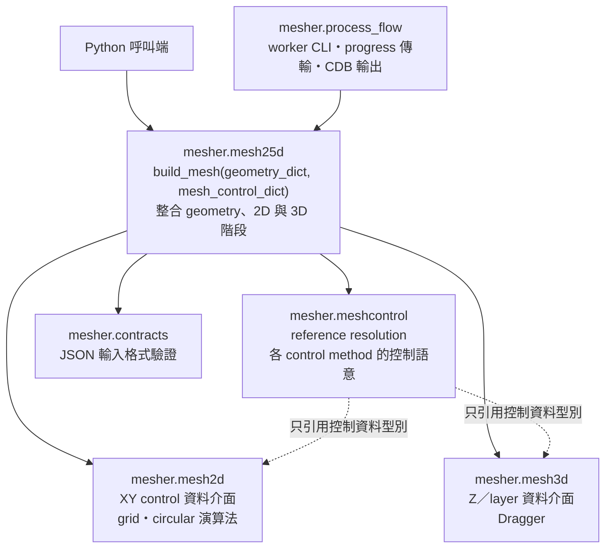
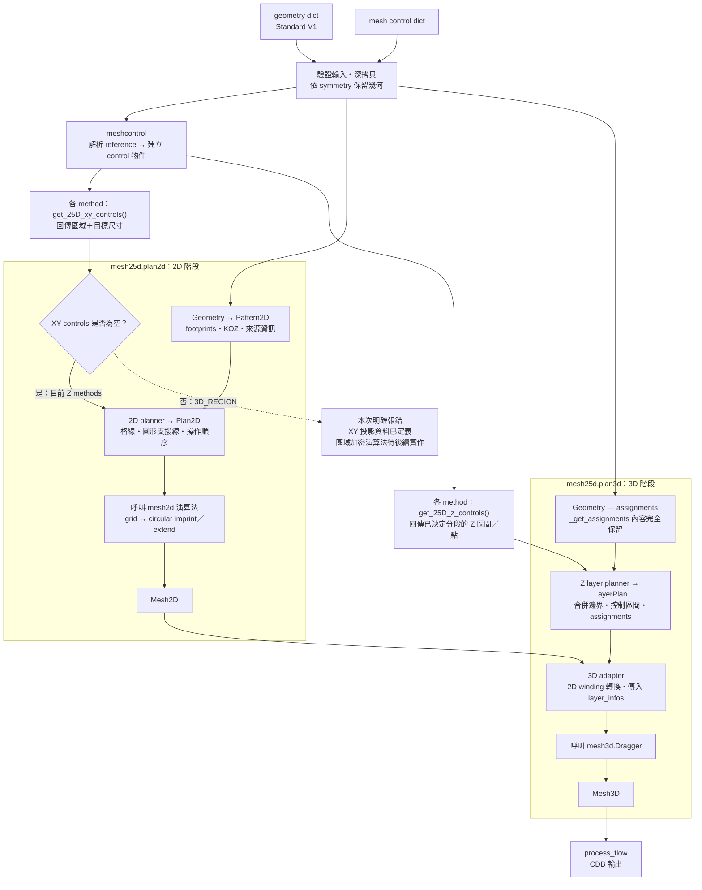

# Mesh25D 架構與資料流

`mesher.mesh25d` 直接接收 Standard V1 geometry dict 與 mesh control dict，整合
2D mesh 與 Dragger。公開入口為 `build_mesh(geometry_structure, mesh_control,
progress=...)`，回傳 `Mesh3D`；各階段的 plan 與 builder 為內部介面。

## 模組責任與依賴

實線表示呼叫或依賴，虛線表示只引用底層的控制資料型別。

`mesh25d` 的內部責任分為 geometry、plan2d、plan3d 與 pipeline：

- `plan2d.py`：規劃格線與圓形操作，產生 `Mesh2D`。
- `plan3d.py`：規劃 Z layers，透過 Dragger 產生 `Mesh3D`。
- `pipeline.py`：串接 geometry、controls、2D 與 3D 階段。

底層 `mesh2d`、`mesh3d` 不反向依賴 `mesh25d`、`meshcontrol` 或 `process_flow`。
共用 control 與資料介面不載入 Dragger 或 optional meshing runtime。

## 建網格資料流

## 控制與規劃的分工

- **Control method 決定控制語意。** TOP／BOT／CENTER 的餘段位置由各 class
  決定；planner 只使用回傳的 constraints，不依 method 名稱重新分段。
- **Planner 整合資料。** `Pattern2D` 保留 `BOX／CIRCLE／POLYGON` 與 `dim`；
  `Plan2D` 決定格線及 circular 操作；`LayerPlan` 合併 assignments 與 Z controls。
- **演算法執行規劃。** Grid、circular 與 Dragger 不解讀原始 mesh control JSON。

XY 使用端定義 `XYRegionControl`，包含 `region`（既有 2D face 格式）與
`element_size`。Z methods 回傳空的 XY controls。`3D_REGION` 只回傳絕對座標
XY 投影，不保留 Z 範圍、不增加 Z constraints；區域加密尚未實作，因此實際
建網格遇到非空 XY controls 時，須在 meshing 前回報 control index／label。

Z constraints 保留 `start`、`end`、`element_size`、`method`，其中 `method`
只作診斷資訊。`Z_POINT` 只增加邊界；重疊區間使用 global size 與有效 controls
的最小尺寸。控制範圍與模型 Z 範圍取交集，不延伸模型。

## Geometry、symmetry 與保護範圍

- 輸入先深拷貝；geometry extraction 不讀取 mesh control。
- Reference 必須在原始模型存在；symmetry 排除的目標，其 control 不生效。
  保留 container 的相對座標依保留子樹的 bounds 計算；多個符合目標仍各自展開。
- **`_get_assignments` 的名稱、參數與完整內容保持原樣，只搬移位置。**
  原有 priority、材料配置、KOZ、bump stage 與 assignment 行為須保留。
- Dragger 的分層、節點共用及 connectivity 行為保留；winding 轉換在 3D adapter。

## 遷移與驗證

Python 呼叫端改用 `mesher.mesh25d.build_mesh`；舊 builder／translator 與 control
轉換路徑移除。Worker CLI、CDB、metadata、progress 事件及目前 JSON contract
保持相容；不支援舊版座標格式。

驗證包含原始碼比對、無 controls 的 mesh／CDB 回歸、Z 分段與重疊、reference
及 symmetry、XY 投影與明確拒絕、輸入不變、import boundaries、完整測試及 build。
