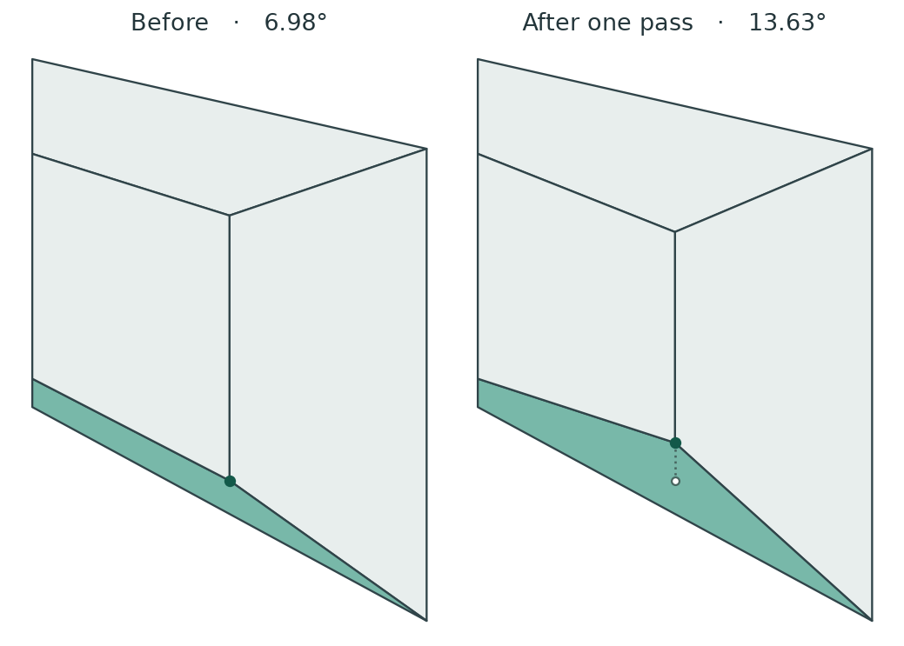

# Quad4 unit 的局部平滑：用半步移動打開尖角

adapter 在粗細網格之間建立轉接時，unit 邊界上可能同時有一小段短邊和一條長邊。這些邊的端點必須與相鄰 unit 對齊，但模板在 unit 內新增的點通常還有調整空間。Smart Laplacian smoothing 利用這個自由度：用鄰點提出一個便宜的候選位置，再由受影響的元素決定是否接受。

## 從一個內點算起



這個例子用截圖中的六個邊界點重建。沿用畫面座標，Y 往下增加。左圖下方的內點約在 `p = (493, 928)`。沿著連在它身上的三條邊往外走，會遇到左邊界的 `(104, 727)`、上方內點 `(493, 405)` 和右下角 `(882, 1205)`。三點的平均位置約為 `c = (493, 779)`。

半步的位置是 `p + 0.5 × (c − p) ≈ (493, 853.5)`。三個鄰點的水平位移剛好抵銷，垂直方向則把內點往上拉約 75 px。右下角因此打開。同樣的平均公式也適用於傾斜或旋轉過的 unit。

| 整個 unit 的量測 | 原始模板 | 平滑一輪後 |
|---|---:|---:|
| 最小內角 | 6.98° | 13.63° |
| 最小 scaled Jacobian | 0.121 | 0.236 |
| 最差元素的最長邊／最短邊 | 15.805 | 15.805 |

## 為什麼要分開看兩個品質指標

對每個逆時針的 Quad4，計算以下兩個量。

- **邊長比 A** 等於最長邊除以最短邊，越接近 1 越好。圖中綠色元素的最長邊和最短邊都在固定邊界上，所以內點往上移後，比值仍是 15.805。
- **最小 scaled Jacobian J** 取四個角的最小值。若 u、v 是沿周界連續的兩個有向邊向量，該角的值為 `cross(u, v) / (|u| × |v|)`。對凸四邊形，這等於內角的正弦。角度接近 0° 或 180° 時數值趨近 0；直角得到 1。保留叉積的正負號，也能辨識轉向錯誤的角。

adapter 用 `max(A, 1/J) > 4` 找出值得檢查的元素。圖中的綠色元素在移動前後都由 A 主導，合併評分相同。如果要求這個評分嚴格下降，就會錯過圖中的改善。因此接受移動時，改為分別比較整圈元素的最大 A 與最小 J。

## 一輪平滑如何執行

1. LINE 與 corner 的 unit 選定後，先找出評分超過 4 的 quad，優先走訪最差 quad 的新增內點。原有節點、unit 邊界和共享接線上的點都固定，包括轉接線上的共用中點。
2. 對每個候選內點，以沿邊直接相連的鄰點計算平均位置。用與該點共用頂點的**所有 quad** 評估移動，包括原本品質良好的元素。若這一圈已因先前的移動而達到門檻，就跳過。
3. 先試半步。要求整圈每個 quad 的各角維持正轉向並通過凸性容差，每條邊都長於幾何容差。接著比較整圈的最大 A 與最小 J：兩項都須持平或改善，且至少一項的改善超過浮點誤差。個別鄰居的角度可以變小，只要仍符合上述整圈條件。
4. 半步被拒絕才試四分之一步。兩次都被拒絕便保留原位。接受後立即更新座標，下一個內點會使用更新後的位置。整層最後仍要通過幾何驗證；若移動造成非相鄰邊過於接近等問題，會還原本輪移動，再驗證原始配置。

每個候選點最多試兩次，每次只重算它周圍的 quad。即使某個點連到很多元素，整個 unit 的相鄰關係總數仍等於四倍的 quad 數，因此這一輪的額外工作量隨元素數線性成長。一次掃描的結果會受走訪順序影響；固定步長也可能錯過其他方向上的改善。

## 對照程式與重現案例

先讀候選步的接受條件，再看測試裡「半步讓另一個角變差、四分之一步卻可以接受」的案例，就能對照步長和品質之間的取捨。[演算法實作](../src/mesher/mesh2d/adapter/layer/_construction/smoothing.py) · [回歸測試](../tests/unit/mesh2d/test_unit_smoothing.py)

在專案根目錄可重跑圖中的案例及其他邊界條件。

```sh
venv/bin/python -m unittest -v tests.unit.mesh2d.test_unit_smoothing
```

本次實作在六個 adapter benchmark 上，同機各量五次的耗時中位數相較修改前介於 −1.43% 與 +3.03%。這組數字可作為日後調整步長或掃描次數時的比較基準。[效能測試腳本](../benchmarks/mesh2d/benchmark_adapter_regressions.py)

若想繼續研究局部平滑，可從 Freitag 的論文閱讀以品質條件篩選 Laplacian 候選點的思路。本文中的門檻 4、兩個步長及 Quad4 的雙指標判定是本專案的實作選擇。[On Combining Laplacian and Optimization-Based Mesh Smoothing Techniques](https://www.osti.gov/servlets/purl/505716)
