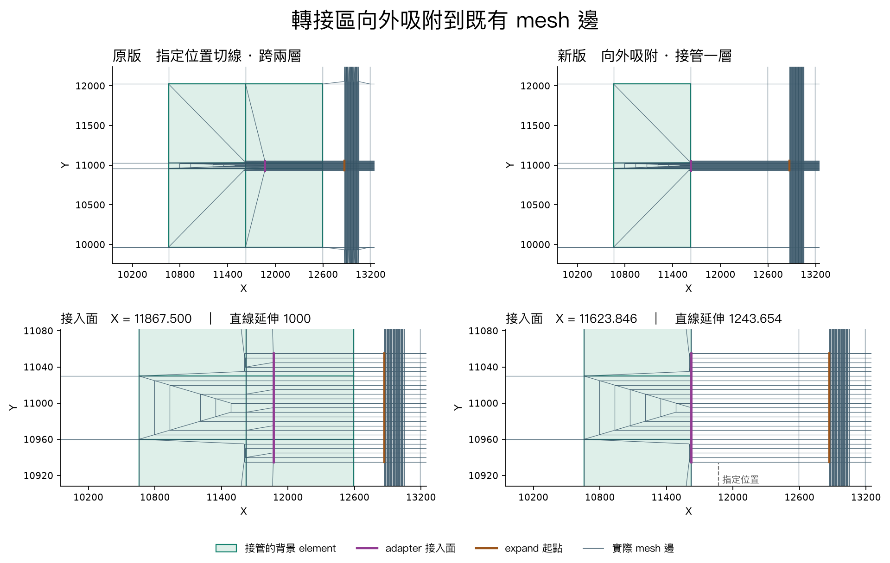

# Line-pair imprinting

This independent NumPy-only mesher does not change the existing adapter or
process-flow pipeline. It generates a new `Mesh2D` from a simple orthogonal
exterior, rectangular directional controls, and finite orthogonal patterns.

```python
from mesher.mesh2d.imprint_line import imprint_lines

mesh = imprint_lines(
    2.0,
    [{
        "direction": "x",
        "line1": [[4, 4], [4, 6]],
        "line2": [[6, 4], [6, 6]],
        "points": [[4, y] for y in (4, 4.4, 4.8, 5.2, 5.6, 6)],
        "line1_expand_size": 2.0,
        "line2_expand_size": 3.0,
    }],
    pattern_lines=[],
    outer_outline=[[-2, -2], [14, -2], [14, 12], [-2, 12]],
    min_transition_size=0.5,
)
```

For `direction="x"`, the two lines are vertical cross sections with identical
Y spans, and only the Y components of `points` define dense lines. Transpose
this definition for `"y"`. A rectangular focus uses both directions. Section
endpoints are included automatically. `line1_expand_size` and
`line2_expand_size` are both required finite, nonnegative scalar distances.
They follow `line1` and `line2` respectively, even when their ordering is
reversed. To use the same distance at both ends, explicitly set both fields to
that value. The former `expand_size` scalar/tuple input is no longer supported.

## Controls from boxes

```python
from mesher.mesh2d.imprint_line import BoxPairSpec, get_pair_line, imprint_lines

outer = [[0, 0], [12, 0], [12, 12], [0, 12]]
controls: list[BoxPairSpec] = [{
    "box": [1, 4, 3, 6],
    "x_points": [[1, 4], [1, 4.4], [1, 4.8], [1, 6]],
    # Omit y_points to generate only the X pair (left/right sides).
}]
pairs = get_pair_line(
    controls,
    expand_size=0.5,
    outer_outline=outer,
    distance=2.0,
)
mesh = imprint_lines(
    2.0, pairs, outer_outline=outer,
    min_transition_size=0.5,
)
```

`get_pair_line(boxes, expand_size, outer_outline=None, distance=None)` accepts
an iterable of `BoxPairSpec` mappings. Each requires `box=[x1, y1, x2, y2]`;
optional `x_points` and `y_points` enable the respective pairs. It returns
`LinePair` dictionaries in box order, X before Y when both are enabled.
X pairs join the left/right sides; Y pairs join the bottom/top sides.
`line1` is always the lower-coordinate side. Choosing a direction controls a
pair of opposite sides, not an individual side.

Points are finite `(n, 2)` absolute XY coordinates. X pairs use only their Y
components; Y pairs use only their X components. The transverse component must
lie within the box span. The other component must be finite but need not lie
on `line1` or within the box. The helper copies points into independently owned
lists without sorting, deduplicating, projecting or adding endpoints.
`imprint_lines` handles normalization, includes section endpoints automatically,
and checks meshing resolution.

Omitting a point field disables that direction. An empty list (or an empty
`(0, 2)` array) enables it with no interior samples; the mesher still includes
the two endpoints. Omitting both fields produces no pairs but still validates
the box. `None` is invalid. Unknown fields, invalid shapes, nonfinite values
and transverse coordinates outside the box raise `ValueError` identifying the
input position, such as `boxes[2].x_points`.

Sampling belongs to the caller. For example, this enables only X with intervals
of 5 followed by intervals of 20:

```python
pairs = get_pair_line([
    {"box": [10, 0, 30, 50],
     "x_points": [[10, y] for y in (0, 5, 10, 30, 50)]},
], expand_size=2)
```

To enable both directions, supply both fields; their distributions can differ.
For equal subdivisions, callers can use `numpy.linspace` and construct XY
points. For fixed spacing with a shorter final interval, construct the interior
positions and append the exact endpoint. The former bare box arrays and
`spacing` argument are no longer supported; no compatibility mode is provided.

Without an outline and threshold, selected sides use `expand_size`. Supply both
`outer_outline` and `distance` to measure each selected side outward,
perpendicular to that side. Its expansion becomes the first boundary-contact
distance `d` only when `d < distance`; equality keeps `expand_size`. This
replacement can increase the default expansion. Concave outlines consider the
entire side, including endpoint contacts, rather than just its midpoint or the
outline bounding box. In the first example, only the left expansion changes,
from 0.5 to 1.0.

Boxes require finite coordinates, `x1 < x2`, and `y1 < y2`. With an outline,
each box must be fully contained, even if neither direction is enabled;
touching is allowed and has zero outward distance on that side. Outlines use
the existing simple orthogonal-loop format and default geometry tolerance,
accepting either winding and an optional repeated closing vertex. Expansion
and threshold must be finite and nonnegative. Supplying only one of
outline/threshold raises `ValueError`. Empty input returns an empty list;
inputs are never modified.

## Placement and topology

The mesher first builds a reference grid from the exterior, finite input
patterns, the symmetry axes and `element_size`. For each end of a line pair,
the requested expansion is the minimum straight distance. From that position
the mesher searches outward for the first reference edge spanning the band.
An exact match is eligible. All reference edges follow the same rule,
including edges formed by input patterns. Dense lines continue to the selected
edge. The adapter occupies the immediately adjoining outward layer and rebuilds
each cell across the band in full.

- Each reference rectangle has one mesh. All controls contribute their fixed
  lines and shared edge contacts before local construction, including parallel
  and perpendicular adapters arriving in the same cell. Same-direction straight
  regions with overlapping interiors combine their samples.
- The outer face reconnects to the existing coarse nodes. A required contact on a shared edge
  subdivides its neighbour. Where a generated grid level and a required control
  coincide within tolerance, their shared vertex uses the exact control
  coordinate locally. Distant coarse cells retain their reference coordinates.
- `min_transition_size` sets the minimum longitudinal depth of the adjacent
  layer. If a layer is too shallow, the search continues outward. When no
  eligible layer fits before the outline, each dense line continues to its own
  exterior contact.
- Patterns and their retained endpoints keep their original float64 coordinates.
  Mesh edges also cover `x=0` and `y=0` wherever they meet the domain.
  Fixed coordinates follow the package tolerance
  policy, including `fixed_constraint_conflict` for incompatible inputs.
- A single dense face uses the nested rectangular unit where it fits. Cells
  with internal lines or several incoming faces can contain Quad4s and padded
  Tri3s (`[a, b, c, c]`). Every exterior edge belongs to a Quad4. If required
  exterior contacts change boundary parity, one additional local boundary
  node restores an even total. Generated edges must exceed the geometry
  tolerance (default `1e-3`).
- The output is deterministic, its nodes have zero Z, and inputs remain
  privately owned by the caller. Area, oriented edge incidence, exact segment
  coverage and fixed endpoints are checked before returning the mesh.
  `max_elements` bounds intermediate partitions and final elements.
  Planning and resolution errors carry an `ImprintLineError` code and context.

The comparison uses the same corner from `examples/debug_imprint_line.py` in
both meshes. The source at X = 12867.5 requests an expansion of 1000 to the
left. The first eligible mesh edge is at X ≈ 11623.846. The straight extension
is about 1243.654, followed by one layer of three coarse cells.



The [earlier corner comparison](../../../../docs/images/imprint-whole-cell-corner.png)
shows the change from cutting pattern lines to rebuilding whole cells.

Valid scalar parameters alone do not guarantee that the requested geometry can
be meshed at that resolution. For example, a fixed gap of `0.0021` with
`element_size=0.00104` requires at least three intervals, whose average length
is below the default `0.001` tolerance. This raises `feature_below_resolution`;
neither the fixed constraints nor the size limit are relaxed. Other diagnostics
include `sizing_no_progress` for a cut that fails to split its target,
`locked_sizing_conflict` for exhausted sizing candidates, and `constraint_not_preserved`
if the final mesh loses a required segment or endpoint. Errors include the
stage and relevant bounds or source indices. Other mesh generators retain
their existing normalization and snapping behavior.

## Verification and previews

From the repository root:

```sh
PYTHONPATH=src venv/bin/python -m unittest discover -s tests/unit/mesh2d/imprint_line -t .
PYTHONPATH=src venv/bin/python examples/imprint_lines.py --output /tmp/imprint-lines
PYTHONPATH=src venv/bin/python examples/imprint_boxes_outline.py --output /tmp/box-outline
PYTHONPATH=src venv/bin/python examples/imprint_thin_transition.py --output /tmp/imprint-thin-transition
PYTHONPATH=src venv/bin/python benchmarks/mesh2d/benchmark_imprint_lines.py --case separated --repeats 5
PYTHONPATH=src venv/bin/python benchmarks/mesh2d/benchmark_imprint_lines.py --case overlap --repeats 5
```

The example saves four actual meshes as NPZ files, individual PNG previews,
an overview, and mesh counts. Both examples call the public `imprint_lines` API.
Their plots mark input controls, slanted quads, and triangles; they do not infer
planner region labels. The die example uses fixed zoom windows. Matplotlib is
only needed to render these examples.

`imprint_thin_transition.py` uses a 50-by-2000 box with expansion 1000,
`element_size=1000`, `min_transition_size=100`, and point spacing 10. It verifies
actual straight mesh-edge coverage for the requested expansion on all four
sides, slanted cells in each complete coarse-cell footprint, and coarse outer
edge nodes. It saves the mesh NPZ, a JSON report, an equal-scale overview, and
top/bottom close-ups with explicitly unequal display scales. An optional
`--baseline /path/to/before.npz` adds a comparison against an actual old mesh
generated with the identical inputs; the script does not simulate old behavior.

`imprint_boxes_outline.py` recreates the hand-drawn layout with 14 boxes in a
100-by-130 exterior (illustrative dimensions). It calls `get_pair_line` followed
by `imprint_lines`, with spacing 2, default expansion 2, and outline threshold 12.
It saves a layout/mesh overview, actual before/after mesh close-ups, both meshes
as NPZ, the generated controls, and a JSON report. Orange regions show the
requested extensions to the outline, not inferred planner region labels.
The example checks actual mesh-edge coverage for all 82 sampled lines across
the 15 selected sides before saving its previews. Interior controls retain the
default expansion; the mesher can still extend them further during planning.

Each benchmark has 100 pairs, 100 points per pair, 1000 finite patterns, and
a 102,400-cell unconstrained reference grid. Each repetition uses a fresh
process and times the complete public call, including validation. The script
reports time, output size, peak RSS, and a deterministic mesh hash. Ten seconds
is a same-host acceptance target for these fixtures, not a guarantee for
arbitrary geometry or output size.

The overlap fixture contains 25 aligned two-focus groups. Offsetting both
fine-coordinate sets can produce substantially more cells: a 25-group case
with 100 points per pair exceeds the default million-element budget. Increasing
that budget permits larger outputs but does not preserve the timing target.
